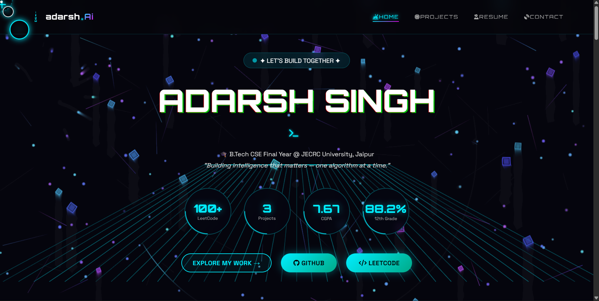
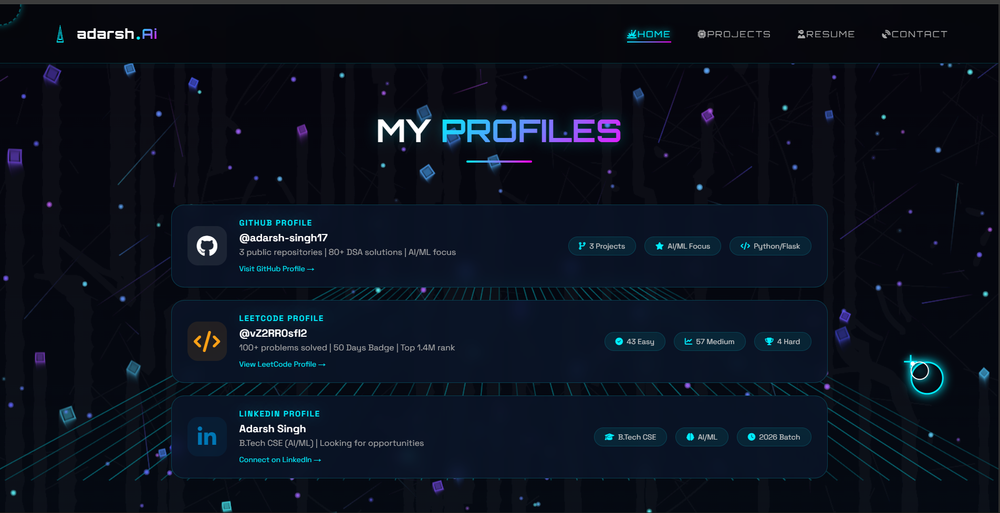
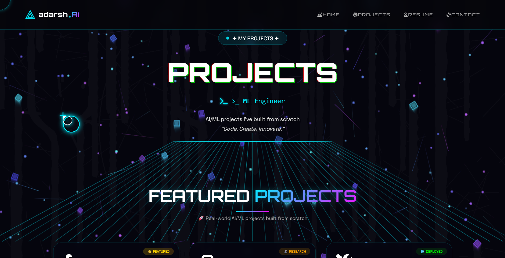
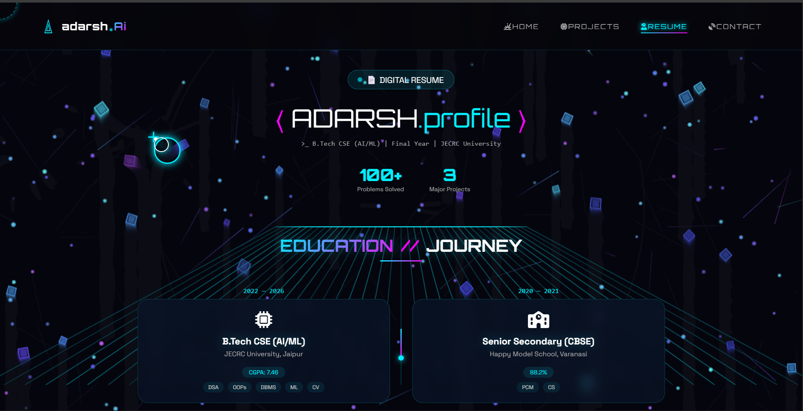

<div align="center">

# 👋 Hi, I'm Adarsh Singh

### 🧠 AI/ML Engineer · Deep Learning · GenAI · Agentic AI

> *Building intelligent systems that understand, reason, and act* ⚡

<br/>

[](https://adarsh-portfolio-48jh.onrender.com)
[](https://github.com/Adarsh-SSingh)
[](https://www.linkedin.com/in/adarsh--ssingh/)
[](https://leetcode.com/Adarsh-SSingh)

<br/>


</div>

---

## 🧠 About Me

I'm a **B.Tech CSE Student** with a deep obsession for **AI, Machine Learning, and intelligent systems**.

I don't just train models — I build **systems that think, reason, and act**.

<table>
<tr>
<td width="50%">

### 🎯 Focus Areas
- 📊 **Machine Learning** — Regression, Classification, Clustering, Ensembles
- 🧠 **Deep Learning** — CNNs, RNNs, LSTMs, GRUs, Transformers
- 🔤 **NLP** — Text processing, embeddings, sequence models
- ✨ **GenAI** — LLMs, RAG, Prompt Engineering, Fine-tuning
- 🤖 **Agentic AI** — Autonomous agents, tool use, planning

</td>
<td width="50%">

### 🚀 Currently Building
- 🤖 **VICTOR** — AI Voice Assistant (Agentic AI)
- ✍️ **Quote Generator** — LSTM/GRU/RNN text generation
- 📚 Learning **LLM fine-tuning** & **RAG pipelines**
- 🧪 Exploring **Multi-agent systems**

</td>
</tr>
</table>

---

# 🌐 About This Portfolio Website

> The portfolio you're looking at is a **Flask-powered web application** with a futuristic glassmorphic UI.

## ✨ Website Features

<div align="center">

| Feature | Description |
|:-------:|:------------|
| 🎨 **Futuristic UI** | Neon + Glassmorphism design language |
| 🌌 **3D Neural Background** | Interactive particle system |
| 🎯 **Custom Cursor** | Target-lock animation with particle trail |
| ✨ **Smooth Animations** | Scroll-based transitions |
| 📱 **Fully Responsive** | Mobile → Desktop optimized |

</div>

## 📸 Screenshots

<div align="center">

### 🏠 Home Page



<br/><br/>

### 👤 Profile Page



<br/><br/>

### 💼 Projects Page



<br/><br/>

### 📄 Resume Page



</div>

## 📂 Project Structure

```
Portfolio/
│
├── 🐍 app.py                      # Flask application
├── 📋 requirements.txt            # Python dependencies
├── 📖 README.md                   # This file
├── 🚫 .gitignore
├── 📄 LICENSE                     # MIT License
│
├── 📁 static/
│   ├── 🎨 style.css
│   ├── 📁 images/
│   └── 📁 screenshots/
│
└── 📁 templates/
    ├── 📄 base.html
    ├── 🏠 index.html
    ├── 💼 projects.html
    ├── 📄 resume.html
    └── 📬 contact.html
```

## 🛠️ AI/ML Tech Stack

<div align="center">

| Category | Technologies |
|:--------:|:-------------|
| 💻 **Languages** | Python · C++ · SQL |
| 🧠 **Deep Learning** | TensorFlow · Keras · PyTorch |
| 📊 **Machine Learning** | Scikit-learn · XGBoost · LightGBM |
| 🔤 **NLP** | NLTK · spaCy · Hugging Face Transformers |
| ✨ **GenAI** | OpenAI API · LangChain · RAG · Vector DBs |
| 🤖 **Agentic AI** | AutoGen · CrewAI · LangGraph |
| 📈 **Data Science** | NumPy · Pandas · Matplotlib · Seaborn |
| ⚙️ **MLOps** | Git · Docker · Streamlit · Render |
| 🗄️ **Databases** | MySQL · MongoDB · ChromaDB |

</div>

---

## 🚀 Featured Projects

<div align="center">

| Project | Description | Tech Stack |
|:-------:|:------------|:----------:|
| 🤖 **VICTOR** | AI Voice Assistant with agentic capabilities | Python · LLMs · Voice AI |
| ✍️ **Quote Generator** | Text generation using LSTM, GRU, RNN | TensorFlow · Streamlit |
| 🧠 **ML Projects** | Multiple supervised/unsupervised models | Scikit-learn · Pandas |
| 🚧 **Coming Soon** | GenAI + Agentic AI systems in progress | TBD |

</div>

### 🎯 Deep Dive — Quote Generator

> An end-to-end deep learning project comparing **LSTM, GRU, and Vanilla RNN** architectures for neural text generation.

**Highlights:**
- 🧠 Trained on **3,038 quotes** → **85,271 training samples**
- ⚡ **3 models** compared: LSTM, GRU, RNN
- 🎨 Premium glassmorphic Streamlit UI
- 🚀 Deployed on Render

[](https://vani-verse-vault-quill-studio.onrender.com/)
[](https://github.com/Adarsh-SSingh/Quote-Predictor)

---

## ✨ Portfolio Features

<div align="center">

| Feature | Description |
|:-------:|:------------|
| 🎨 **Futuristic UI** | Neon + Glassmorphism design |
| 🌌 **3D Neural Background** | Interactive particle system |
| 🎯 **Custom Cursor** | Target-lock animation with particle trail |
| ✨ **Smooth Animations** | Scroll-based transitions |
| 📱 **Fully Responsive** | Mobile → Desktop optimized |

</div>

---

## 📊 Achievements

<div align="center">

| 🏆 | Achievement |
|:--:|:------------|
| 💻 | **100+** LeetCode problems solved |
| 📂 | **80+** DSA implementations |
| 🚀 | **Multiple** AI/ML projects deployed |
| 🧠 | Strong foundation in **DL, NLP, GenAI** |
| 🎯 | Focus on **real-world AI systems** |

</div>

---

## 🗺️ Learning Roadmap

<details>
<summary><b>🔍 Click to expand</b></summary>

<br/>

### ✅ Completed
- 📊 **Machine Learning** — Regression, Classification, Clustering, Ensembles
- 🧠 **Deep Learning** — CNNs, RNNs, LSTMs, GRUs
- 📈 **Data Science Stack** — NumPy · Pandas · Matplotlib · Seaborn
- 🔤 **NLP Basics** — Tokenization, Embeddings, Sequence Models
- 🚀 **Model Deployment** — Streamlit, Render
- 💻 **DSA** — 100+ LeetCode problems

### 🚧 In Progress
- 🔄 **Transformers** — Attention mechanism deep dive
- 🔤 **Advanced NLP** — BERT, GPT architectures
- 🌐 **FastAPI** — Building AI-powered APIs
- 📦 **Model Serving** — Production-grade deployment

### 🔮 Upcoming
- ✨ **GenAI** — LLMs, RAG, Prompt Engineering, Fine-tuning (LoRA/QLoRA)
- 🤖 **Agentic AI** — AutoGen, CrewAI, LangGraph, Tool Use
- 🎯 **Multi-Agent Systems** — Autonomous reasoning agents
- 🗣️ **Voice AI** — Whisper, TTS, STT pipelines
- ⚙️ **MLOps** — MLflow, DVC, CI/CD for ML
- 📚 **Research Papers** — Implementation & experimentation

</details>

---

## 📂 Project Structure

```
Portfolio/
│
├── 🐍 app.py                      # Flask application
├── 📋 requirements.txt            # Python dependencies
├── 📖 README.md                   # This file
├── 🚫 .gitignore
├── 📄 LICENSE                     # MIT License
│
├── 📁 static/
│   ├── 🎨 style.css
│   ├── 📁 images/
│   └── 📁 screenshots/            # Portfolio preview images
│       ├── home.png
│       ├── home2.png
│       ├── project.png
│       └── resume.png
│
└── 📁 templates/
    ├── 📄 base.html
    ├── 🏠 index.html
    ├── 💼 projects.html
    ├── 📄 resume.html
    └── 📬 contact.html
```

---

## 🚀 Run Locally

### 1️⃣ Clone Repository

```bash
git clone https://github.com/Adarsh-SSingh/Portfolio.git
cd Portfolio
```

### 2️⃣ Create Virtual Environment

```bash
python -m venv venv

# Windows
venv\Scripts\activate

# Mac / Linux
source venv/bin/activate
```

### 3️⃣ Install Dependencies

```bash
pip install -r requirements.txt
```

### 4️⃣ Run Application

```bash
python app.py
```

App opens at **http://127.0.0.1:5000** 🎉

---

## 🌐 Deployment

### Render

| Setting | Value |
|:--------|:------|
| **Build Command** | `pip install -r requirements.txt` |
| **Start Command** | `gunicorn app:app` |
| **Runtime** | Python 3 |

---

## 🔗 Connect With Me

<div align="center">

[](https://github.com/Adarsh-SSingh)
[](https://www.linkedin.com/in/adarsh--ssingh/)
[](https://leetcode.com/Adarsh-SSingh)
[](https://adarsh-portfolio-48jh.onrender.com)

</div>

---

## ⚡ Vision

<div align="center">

> ### *"Building AI systems that don't just respond — they understand, reason, and act."*

</div>

---

## 📄 License

This project is licensed under the **MIT License** — see the [LICENSE](LICENSE) file for details.

---

<div align="center">

### ⭐ If you like my work, give it a star!


<br/><br/>

**Built with ❤️ and a lot of ☕ by Adarsh Singh**


</div>
